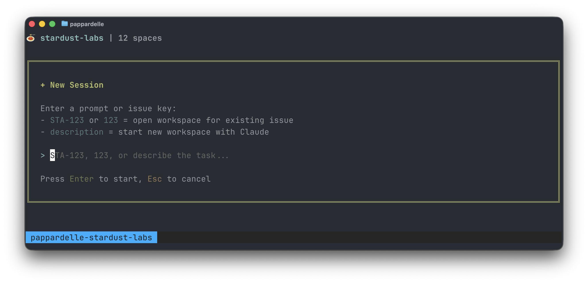
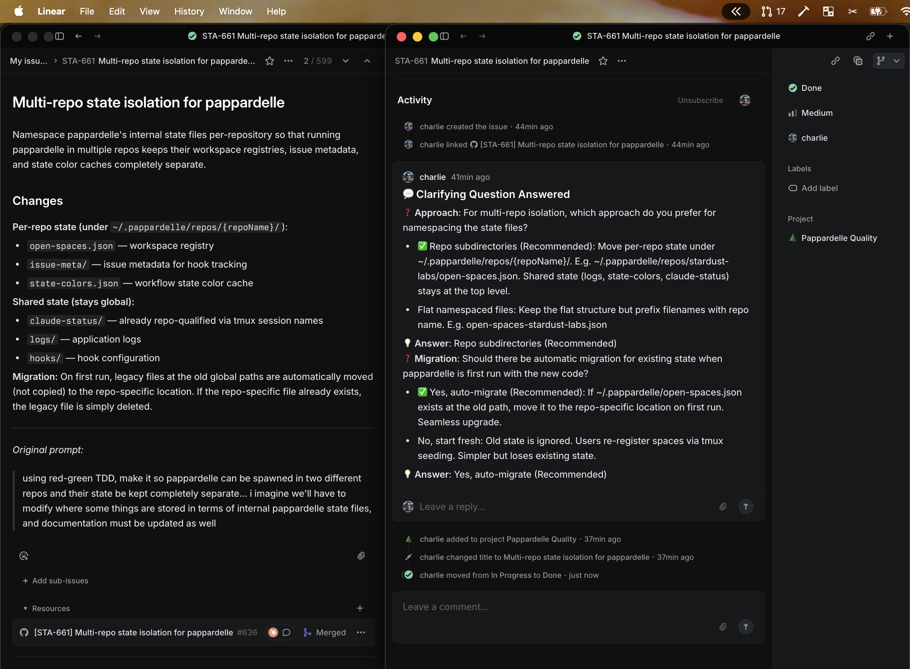
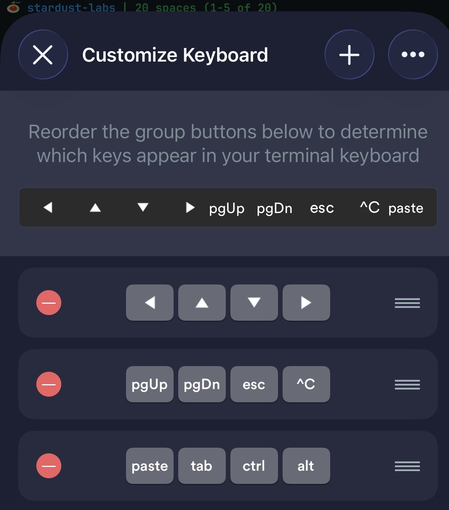

# 🦀🍝🦀 Pappardelle 🦀🍝🦀

[](https://github.com/chardigio/pappardelle/actions/workflows/test.yml)
[](https://bun.sh/)
[](LICENSE)

A TUI for multi-clauding without losing your marbles.

You type a description, it reads or creates an issue in Linear, Jira or beads, spawns a configured git worktree, builds a PR/MR, and starts a Claude Code session alongside a companion pane (gitui by default, configurable to any command) — all wired together in a 3-pane tmux layout you can navigate with simple, customizable keystrokes.

**Video:**

https://github.com/user-attachments/assets/abeaf413-5a1e-448a-ac53-2956a8ada5bf

---

## Table of Contents

1. [Installation and Getting Started](#1-installation-and-getting-started)
2. [Understanding tmux in Pappardelle](#2-understanding-tmux-in-pappardelle)
3. [Spawning New Sessions](#3-spawning-new-sessions)
4. [Spec-Driven Development Mindset](#4-spec-driven-development-mindset)
5. [Customizing Your Configuration](#5-customizing-your-configuration)
6. [Advanced: Doom-coding with Pappardelle](#6-advanced-doom-coding-with-pappardelle)
7. [Advanced: Wrangling Multi-Repo Changes](#7-advanced-wrangling-multi-repo-changes)
8. [Reference](#8-reference)

---

## 1. Installation and Getting Started

The fastest way to get set up is with `/init-pappardelle`.

Install Pappardelle. This builds the CLI and installs its plugin into Claude Code, Codex and agy: the hooks below plus five skills — `/init-pappardelle` (setup wizard), `/update-pappardelle` (update to latest), `/configure-pappardelle` (interactive config editor), `/sous-chef` (optional workspace coordinator), and `/link-pr` (record a PR/MR for the workspace):

```bash
curl -fsSL https://raw.githubusercontent.com/chardigio/pappardelle/main/install.sh | bash
```

Run the setup wizard from any repo where you want to use Pappardelle. It writes your `.pappardelle.yml`:

```bash
claude /init-pappardelle
```

For manual installation, see [Section 8: Reference](#8-reference). For the full config format, see the [configuration reference](pappardelle-config.md).

### Launch Pappardelle:

```bash
pappardelle
```


---

## 2. Understanding tmux in Pappardelle

### The 3-pane layout

When you launch `pappardelle`, it creates a tmux session with three panes:

- **Left pane** shows the ticket rail. This is where you navigate workspaces, create new ones, and trigger actions.
- **Center pane** shows the Claude Code session for whichever workspace is highlighted.
- **Right pane** runs the **companion command** for the highlighted workspace's worktree — [gitui](https://github.com/gitui-org/gitui) by default, or any command you set via `companion_command` (a different git UI, a dev server, a log tailer, …).

### How nested sessions work

Each workspace creates two independent tmux sessions:

- `agent-{repo}-{issue-key}` — runs the configured agent (Claude Code by default; see the `agent_profiles:` config section to run e.g. the OpenAI Codex CLI instead)
- `companion-{repo}-{issue-key}` — runs the companion command (gitui by default)

The center and right panes in the Pappardelle session are "viewers" — they run nested tmux clients that attach to these independent sessions. When you highlight a different workspace in the list, Pappardelle uses `tmux switch-client` to instantly swap which session the viewer pane displays.

This means:

- **Workspaces are independent.** Each agent session runs in its own tmux session. If Pappardelle crashes, your agent sessions keep running.
- **Attach from anywhere.** You can attach to any workspace's agent session from a separate terminal: `tmux -L pappardelle_inner attach -t agent-stardust-labs-STA-631`.
- **Switching is instant.** After the first attachment, switching between workspaces uses tmux's fast `switch-client` path — no process restart, no visible flash.

### Program status

The ticket rail reads [OSC 7501 Program Status Protocol](https://www.superlogical.com/rex/docs/build/program-status) reports (revision 0.4) from programs running in the center pane.

| Agent       | Status source through tmux                                       |
| ----------- | ---------------------------------------------------------------- |
| Codex       | Native reports, no opt-in                                        |
| OpenCode    | Native reports, no opt-in                                        |
| Pi          | Native reports with `PI_PROGRAM_STATUS=1`                        |
| agy         | Native reports with `AGY_CLI_OSC7501=on`                         |
| Claude Code | Existing status hooks; native reports require a capability reply |

| Status                                                   | Indicator                                    |
| -------------------------------------------------------- | -------------------------------------------- |
| Working                                                  | Orange animation                             |
| Idle or done                                             | Green dot                                    |
| Blocked on a question                                    | Blue question mark and attention highlight   |
| Blocked on permission, authentication, or another reason | Red exclamation mark and attention highlight |
| Error                                                    | Red cross                                    |
| Unknown                                                  | Dim question mark                            |

Child records contribute to the workspace indicator. Priority is blocked, error, working, done, then idle; ties prefer the root record, then the latest update. Messages, titles, and progress are saved in snapshots. Workspace auto-removal follows the issue tracker's completion state.

Claude hooks supply fallback status until the pane emits its first valid native report. A capability query alone does not change the source. After native reporting starts, OSC remains authoritative, including after a clear or terminal reset. Matching Claude hook details can supply the working tool or compaction indicator.

Native working and blocked records have no timeout. Returning from the agent command to the login shell emits OSC 133 A and removes active records; done and error survive. Monitoring stays pinned to the agent pane across window selection and splits. Replacing its process creates a new generation. Monitors remain alive when the TUI closes; closing a workspace revokes its snapshots and leases through both the TUI and CLI. Hook fallback retains its ten-minute timeout for active work.

A read-only `pipe-pane` monitor parses status and writes atomic snapshots without wrapping the agent. Agent sessions set Pi and agy's reporting overrides so they report through tmux without capability negotiation. The monitor never injects replies or keyboard input. Existing unrelated pane pipes are left with their owner, with hooks providing fallback. See [installed-agent results and QA evidence](integration-tests/STE-37-verification.md) and [local protocol verification](integration-tests/README.md#program-status).

Existing sessions gain a monitor when the TUI opens.

### tmux version

Pappardelle requires tmux 3.3 or newer; the TUI exits at startup with an error on anything older. Beyond that floor, use a tmux build containing the [synchronized-output fix](https://github.com/tmux/tmux/commit/b2de803871e579565a6f79296f386115142593ed). Stable 3.7c and earlier can expose screen clears before an application finishes a synchronized frame, causing Codex and other TUIs to flash ([tmux/tmux#4983](https://github.com/tmux/tmux/issues/4983)). Pappardelle's incremental renderer reduces redraws, but the tmux fix is also needed to prevent these partial frames.

The fix is currently available in the official [tmux preview builds](https://github.com/tmux/tmux-builds/releases/tag/preview). We verified `20260924-a4a2501b`, which reports `tmux next-3.9`. Preview downloads track upstream development; `next-3.9` alone does not identify the commit. These are prerelease builds until a stable release includes the fix.

To install a preview, select your platform below and run these commands with the [GitHub CLI](https://cli.github.com/) installed. This replaces `~/.local/bin/tmux`; it leaves running servers and their sessions alive.

| Platform            | `TMUX_PLATFORM` |
| ------------------- | --------------- |
| macOS Apple Silicon | `macos-arm64`   |
| macOS Intel         | `macos-x86_64`  |
| Linux ARM64         | `linux-arm64`   |
| Linux x86-64        | `linux-x86_64`  |

```bash
TMUX_PLATFORM=macos-arm64
TMUX_DOWNLOAD_DIR="$(mktemp -d)"
gh release download preview --repo tmux/tmux-builds \
  --pattern "tmux-*-${TMUX_PLATFORM}.tar.gz" --dir "$TMUX_DOWNLOAD_DIR"
tar -xzf "$TMUX_DOWNLOAD_DIR"/tmux-*.tar.gz -C "$TMUX_DOWNLOAD_DIR"
mkdir -p "$HOME/.local/bin"
install -m 755 "$TMUX_DOWNLOAD_DIR/tmux" "$HOME/.local/bin/tmux"
```

Ensure `~/.local/bin` precedes other tmux installations in your `PATH`, or register the downloaded binary with your version manager. Open a fresh shell and check `command -v tmux` and `tmux -V` before restarting.

**Existing servers keep using the old binary.** When ready to end all running workspace processes, run this from a terminal outside tmux, then launch `pappardelle` again:

```bash
tmux -L pappardelle_inner kill-server
tmux kill-server
```

A "no server running" message is harmless. Closing only the Pappardelle window leaves the inner server running. After relaunching, check the running servers with `tmux display-message -p '#{version}'` and `tmux -L pappardelle_inner display-message -p '#{version}'`.

### Recommended tmux config

Pappardelle works with any tmux configuration, but these settings improve the experience — mouse support, Ctrl+Shift+arrow pane navigation, and a clean status bar. See [`examples/tmux.conf`](examples/tmux.conf) and append to your `~/.tmux.conf`. If you don't have one yet:

The file also turns on tmux's extended keys. Without them Shift+Enter (newline in Claude Code) arrives in the panes as a plain Enter. tmux reads `~/.tmux.conf` at server start only, and Pappardelle runs two servers, the TUI one and `pappardelle_inner` for the Claude and companion sessions, so after editing reload both: `tmux source-file ~/.tmux.conf` and `tmux -L pappardelle_inner source-file ~/.tmux.conf`.

```bash
curl -fsSL https://raw.githubusercontent.com/chardigio/pappardelle/main/examples/tmux.conf -o ~/.tmux.conf
```

### Jumping to the sous-chef

Press `Option+s` (`M-s`) from any pane in the Pappardelle window (the rail, an agent pane or a companion pane) to select the `main` space and focus its agent, where the [sous-chef](#skills) runs. The terminal must send Option as Meta (an "Option as Meta" or "Option as Alt" setting). Pappardelle installs this as a tmux key binding, so in your other tmux windows `M-s` still reaches the program running there. Change or turn off the key with [`sous_chef_key`](pappardelle-config.md#sous-chef-key). When the rail has focus, plain `s` does the same. From a script, `pappardelle highlight main --focus` does.

### Exiting Pappardelle

Press `q` in the workspace list pane to quit. This kills the Pappardelle tmux session and all its viewer panes, returning you to your original terminal. Your Claude and companion workspace sessions are **not** affected — they run in independent tmux sessions and will keep going after Pappardelle exits. To reattach, just run `pappardelle` again.

To also kill all workspace sessions, use `Delete` on each workspace from the TUI before quitting, or run `pappardelle close <issue-key>` from a shell (`--yes` skips the question, and is required without a terminal). It runs the same close as `Delete`: deinit hooks, then its sessions end and it leaves the list; the worktree stays on disk. `K` closes every workspace whose issue is already done or canceled in one confirmed step. Or nuke everything with:

```bash
tmux -L pappardelle_inner kill-server
tmux kill-server
```

---

## 3. Spawning New Sessions

### From the command line

Run these from the repository or one of its worktrees:

```bash
pappardelle STE-20
pappardelle "fix auth bug"
pappardelle --profile mobile "fix auth bug"
pappardelle --resume STE-20
```

Successful command-line setup saves the space in the TUI's list. Opening an
existing workspace by issue key resumes it automatically without sending the
configured initialization prompt again. Use `--resume` to skip the prompt for
any input, or `--no-resume` to enable it when the agent session starts. These
commands also work from a sous-chef session. A setup or registration failure
returns a nonzero exit status.

Use `--profile <name>` to select a profile configured in `.pappardelle.yml`
instead of automatic selection. It also works with `--resume`. Bare issue numbers
use the selected profile's team prefix when one is configured.

### Agents in a workspace

Agents can see and change their workspace. In Claude Code, the plugin gives them [MCP tools](#mcp-tools) for this. Everything else, you included, uses the same commands from the command line:

```bash
pappardelle companion hunk diff --watch            # replace this space's companion command
pappardelle companion run --pane app --split right -- npm run dev
pappardelle companion resize app --size 40%        # along the way it was split
pappardelle companion read --pane app              # last lines of a pane
pappardelle companion width 40%                    # this space's companion width in the TUI
pappardelle spaces --json                          # every space: status, title, PR, branch summary
pappardelle read STE-20 --turns 3                  # recent turns of another space's conversation
pappardelle send STE-20 --keys Escape              # press a key in another space's Claude
pappardelle state STE-20                           # working, at a prompt (and its command), limited, idle...
pappardelle wait STE-20 --until ready              # return once it stops working
pappardelle answer STE-20 --option 1               # approve a QA-cleanup command; anything else needs a person
pappardelle schedule STE-20 --after-limit          # send continue when its Codex usage limit resets
pappardelle schedule STE-20 --keep-going --every 10m --nudge 'keep going'
```

Each companion pane other than `main` runs in a tmux session of its own, and the TUI shows it in a framed pane of its own in the companion column. The terminal launchers attach only `main`, so splits show only in the TUI. Run `pappardelle companion --help` for every companion verb.

### From the TUI

Press `n` in the workspace list to open the prompt dialog.



Enter moves focus to a **profile picker** below the prompt, with the
keyword-matched profile already selected — so `Enter`, `Enter` spawns exactly
what the keyword would have chosen on its own. Arrow (or `j`/`k`) to any other
profile to override it without rewording your prompt, or press `/` to filter
the list by name, and `Esc` to go back to editing. The profile also decides which agent runs in the agent pane (see
[Agent profiles](pappardelle-config.md#agent-profiles)), and the choice is
saved with the workspace so reattaching relaunches the same agent.

To run a different agent this once, press `a` on a profile: a tmux popup lists
every agent profile with the config file that defines it (`/` filters the
list by name), and the one you choose shows next to the profile (`→ codex`)
until `Enter` starts it. The override isn't saved with the workspace,
so a later relaunch goes back to the profile's own agent. A bare issue number
or a key no profile claims normally starts on the first `Enter`; when you have
agent profiles to choose from, it gets a one-row picker instead, so `a` has a
row to act on.

### Slash-command autocomplete

Start the prompt with `/` and the **Profile** box gives way to a **Skills** box
listing every skill and command Claude could run from this repo. The list
narrows as you type. `↑`/`↓` move the selection, `Tab` completes the highlighted
name and hands the prompt back to you, and `Esc` dismisses the list without
clearing what you typed.

`Enter` moves the focus into the **Skills** box instead of completing. That
freezes the prompt, so `j`/`k` move the selection there too, `Enter` completes,
and `Esc` returns the focus to the prompt with the list still open.

Once the name you typed is one Pappardelle found on disk, the prompt paints it
cyan. The color outlives the list: it is still there after the space that closes
the list, so a finished `/do-pappardelle fix the picker` still shows you that
the skill is real.

Pappardelle reads four places, repo before user, and a repo entry hides a user
entry of the same name:

| Source        | Path                               |
| ------------- | ---------------------------------- |
| Repo skills   | `<repo>/.claude/skills/*/SKILL.md` |
| Repo commands | `<repo>/.claude/commands/**/*.md`  |
| User skills   | `~/.claude/skills/*/SKILL.md`      |
| User commands | `~/.claude/commands/**/*.md`       |

The completion is a typing aid. It does not change which profile your prompt
matches, and it does not change the text sent to your tracker. A prompt that
does not start with `/` behaves exactly as it always has.

### What gets provisioned

When you create a workspace, Pappardelle runs through these steps:

1. **Profile selection** — Your input is keyword-matched against a profile in `.pappardelle.yml`, and you confirm (or override) the match in the picker.

2. **Issue creation/fetch** — For new descriptions, a Linear (or Jira, or beads) issue is created with a WIP title. For existing issue keys, the issue is fetched.

3. **Git worktree** — An isolated worktree is created at `~/.worktrees/{repo-name}/{issue-key}/`. This is a full working copy of your repo on a new branch, completely isolated from your main checkout.

4. **PR/MR lookup** — When opening workspace apps and links (`o` or `idow --open`), an existing PR (GitHub) or MR (GitLab) is resolved into `${PR_URL}`. Setup-only creation skips this network request, as does opening a profile whose commands, apps, links, and hooks do not use `${PR_URL}` or `${MR_URL}`. When lookup is skipped, the final workspace summary also omits the `PR:` line. Claude and companion sessions start before any PR/MR lookup. Provisioning never _opens_ a PR: the agent opens it at its first real commit. Anything keyed off `${PR_URL}` should be gated with `if_set: PR_URL`.

5. **Project setup** — Profile `commands` are executed (e.g., `xcodegen generate`, dependency installs). Top-level `post_workspace_init` commands also run after the worktree is created (e.g., copying `.env` files).

6. **Agent & companion sessions spawned** — A named tmux session is created and the configured agent (Claude Code by default) is launched inside it. If `initialization_command` is set in `.pappardelle.yml` (e.g., `do`), the agent runs that skill with the issue key: `/do STA-123` in claude, `$do STA-123` in codex. A companion session rooted at the worktree dir is also spawned, running the `companion_command` (gitui by default).

---

## 4. Spec-Driven Development Mindset



Pappardelle's recommended `/do` skill (set via `initialization_command: do` in `.pappardelle.yml`) starts every Claude session with a **planning-first workflow**. Before writing any code, the agent researches and uses Claude Code's `AskUserQuestion` tool to clarify requirements — asking about ambiguous scope, confirming design decisions, and validating edge cases. The goal is to turn a rough prompt into a detailed, unambiguous spec — **written back to the issue description** — before the first line of code is written.

### Why this matters

A one-line prompt like "add dark mode to settings" leaves a lot of questions open: which settings screen? System preference or manual toggle? What colors? The `/do` skill instructs the agent to surface these questions upfront rather than guessing. This front-loaded clarification produces better code on the first pass and fewer revision cycles.

### Automatic Q&A documentation

Every `AskUserQuestion` exchange is automatically posted as a comment on the Linear, Jira or beads issue by the [`comment-question-answered.py`](plugins/pappardelle/hooks/comment-question-answered.py) hook. This means:

- **The issue becomes the single source of truth.** The original prompt, every clarifying question, and every answer are all captured in one place — not scattered across chat windows or terminal scrollback.
- **Anyone reviewing the PR can see the full context.** The issue thread shows exactly what the agent asked, what the developer decided, and why.
- **Record-keeping is automatic.** You don't need to manually document decisions or copy-paste from the terminal. The hook handles it silently in the background.

---

## 5. Customizing Your Configuration

Use `/configure-pappardelle` to interactively edit your config — it walks you through adding profiles, keybindings, hooks, and more using `AskUserQuestion`. Available via the [skills](#skills) or by asking Claude directly (it's model-invocable).

Pappardelle is configured via a `.pappardelle.yml` file at your repo root. The key concepts:

- **Issue watchlist** — Auto-discover issues assigned to you and spawn workspaces for them. Pappardelle polls your issue tracker and creates workspaces for new matching issues. Filter by status, labels, or `key_prefixes` (e.g. watch `STA-*` but not `WAB-*` when one account spans multiple workspaces), and cap how many workspaces a watchlist keeps open with `max_workspaces`. A profile can also declare its own `issue_watchlist`, polled _in addition_ to the top-level one and auto-scoped to that profile's `team_prefix` — so you can watch one status everywhere and a bespoke status (e.g. "For Pappardelle") for a single project.
- **Auto-remove when done** — Opt-in flag (`auto_remove_when_done: true`) that drops a space from the rail as soon as the tracker reports its issue as completed or canceled. Same teardown as pressing `d`; the on-disk worktree is left untouched. Leave the flag off and press `K` instead to clear the finished spaces on demand, behind a confirm dialog.
- **Sous-chef mode** — Opt-in flag (`sous_chef: true`) that tells the agent in the main checkout it coordinates the repo's spaces: it watches them and brings their prompts and questions to you. `/sous-chef` has the full routine.
- **Issue status colors** — Optional `state_colors:` map that overrides the ticket-rail color for named issue statuses (hex or an ANSI color name). Off by default, so the rail keeps the tracker's own colors. Most useful on Jira, where one color often covers both "In Progress" and "In Review". In Review is purple by default on every tracker.
- **Status groups** — Optional `list_view.group_by: status` groups the rail under collapsible headers below the agent spaces: In Progress, In Review and Done, or groups of your own from `list_view.groups`. Collapsed groups are remembered per repo.
- **Companion pane command** — The right pane runs `companion_command` (defaults to `gitui`). Set it to any shell command — a different git UI (`companion_command: lazygit`), a dev server, a log tailer — or `""` to leave a plain shell. A profile can override the top-level value, so per-project profiles can each launch their own process.
- **Profiles** — Per-project-type config (keywords, setup commands, VCS labels, optional `emoji:` shown in the ticket rail). Pappardelle keyword-matches your input to auto-select the right profile. Each profile's `tracker_projects` list both routes existing issues to the right profile (Linear project names; Jira project names or keys; beads ID prefixes) and (Linear only) lands brand-new issues in `tracker_projects[0]`.
- **Agent profiles** — `agent_profiles:` names the CLI a workspace runs (Claude Code by default, or Codex or any other CLI) with its `model`, `effort` and `args`. A profile picks one with `agent_profile:`. Omit `model` and `effort` and no flag is passed, so the CLI picks its own default. The older `claude.model` / `claude.effort` / `claude.extra_args` still work with a deprecation warning, and Pappardelle offers to rewrite them on startup.
- **Template variables** — All string values support `${VAR_NAME}` expansion (`${ISSUE_KEY}`, `${WORKTREE_PATH}`, `${PR_URL}`, profile `vars`, env vars, etc.).
- **Custom keybindings** — Bind single keys to bash commands (`run`), skills (`send_skill`) or text for the agent (`send_to_claude`).
- **Providers** — Pluggable issue trackers (Linear, Jira, beads) and VCS hosts (GitHub, GitLab). Defaults to Linear + GitHub.
- **Built-in file copies** — `.pappardelle.local.yml` and `.claude/settings.local.json` are automatically copied from the main repo to new worktrees (if they exist).
- **Workspace lifecycle hooks** — `post_workspace_init` commands run after worktree creation (e.g., copying `.env` files, installing dependencies). Initialization hooks with `background: true` continue without delaying workspace readiness; their output goes to that workspace's idow log in `~/Library/Logs/stardust-workspace/` (see [Logging](#logging)). `pre_workspace_deinit` commands run before workspace deletion (e.g., closing issues, removing worktrees).

For the full schema, all fields, and examples, see the [configuration reference](pappardelle-config.md).

For a production `.pappardelle.yml` used across a polyglot monorepo (Python backends + Swift iOS apps), see [`examples/monorepo-pappardelle.yml`](examples/monorepo-pappardelle.yml).

---

## 6. Advanced: Doom-coding with Pappardelle

**Video:**

https://github.com/user-attachments/assets/824307b7-73a6-48d2-918f-4a2d75fcb39b

Because Pappardelle runs entirely inside tmux, you can access your full workspace setup from anywhere — all you need is an SSH connection to the machine running it.

### What you need

- **A machine that stays on** — I'm not a Mac Mini guy (yet), I just keep my MacBook plugged in. macOS won't sleep with the lid closed as long as it has power and an active SSH session.
- **[Tailscale](https://tailscale.com/)** — A mesh VPN that makes your dev machine accessible from any network without port forwarding or firewall configuration. Install on both your dev machine and your mobile device.
- **[Termius](https://termius.com/)** (iOS) — A full-featured SSH client for iPhone and iPad with good tmux support, copy/paste, and keyboard shortcuts.

### Nice-to-haves

- **[ntfy](https://ntfy.sh/)** — Push notifications to your phone when Claude needs input. Pappardelle ships with a [`zap-notification.py`](plugins/pappardelle/hooks/zap-notification.py) hook that sends a push via ntfy whenever Claude asks a question or hits a permission prompt. To get it working, set the `PAPPARDELLE_NTFY_TOPIC` environment variable and subscribe to the same topic in the ntfy app on your phone. That variable is the only switch: leave it unset and the hook stays silent. This way you don't have to babysit the terminal, just wait for the buzz.
- **[Wispr Flow](https://apps.apple.com/us/app/wispr-flow-ai-voice-keyboard/id6497229487)** — Voice-to-text dictation that works system-wide, including inside Termius. Lets you talk to Claude instead of thumb-typing on a phone keyboard.

### Recommended Termius keyboard shortcuts

Termius lets you customize the shortcut bar above the on-screen keyboard — these are my favorite groups for Pappardelle:



- **Arrow keys** — scroll through Claude output and navigate the workspace list
- **pgUp / pgDn** — cycle between tmux panes (requires the `PageUp`/`PageDown` bindings from [`examples/tmux.conf`](examples/tmux.conf))
- **esc / ^C** — cancel prompts, exit modes
- **paste / tab / ctrl / alt** — general terminal essentials

Also recommended: toggle on **Settings > Hide the AI widget** in Termius for extra screen real estate.

### Useful keybindings

When you're doom-coding from your phone, you want one-tap access to open the PR on the device in your hand. Bind a key that sends an ntfy notification with a clickable link:

```yaml
keybindings:
  - key: 'z'
    name: 'Zap PR'
    # Use `--search "head:${ISSUE_KEY}"` (tokenized prefix match) rather than
    # `--head ${ISSUE_KEY}` (exact match) so follow-up branches like
    # ${ISSUE_KEY}-FOLLOW-1 are also discoverable from the parent issue key.
    # Sort by updatedAt desc — when a branch name has been reused (e.g. an
    # old merged PR + a freshly opened one), surface the PR you're actually
    # working on, not the oldest stale match.
    run: >
      PR_JSON=$(gh pr list --search "head:${ISSUE_KEY}" --state all --json number,url,updatedAt
        -q 'sort_by(.updatedAt) | reverse | .[0]' 2>/dev/null);
      PR_NUM=$(echo "$PR_JSON" | jq -r '.number // empty');
      PR_URL=$(echo "$PR_JSON" | jq -r '.url // empty');
      if [ -n "$PR_NUM" ]; then
        curl -d "${ISSUE_KEY} GitHub PR #$PR_NUM"
          -H "Click: $PR_URL"
          ntfy.sh/${PAPPARDELLE_NTFY_TOPIC};
      fi
```

Press `z` on a workspace and your phone buzzes with a notification — tap it and the PR opens in the GitHub app.

---

## 7. Advanced: Wrangling Multi-Repo Changes

Pappardelle is designed for single-repo workflows, but (experimentally) you can extend it to orchestrate changes across multiple repositories using a parent (pappa) repo.

### The setup

Create a parent repository that serves as the orchestration hub:

```
my-workspace/
├── .pappardelle.yml
├── .claude/
│   ├── settings.json         # shared settings + plugins
│   └── skills/
│       ├── do/
│       │   └── SKILL.md      # initialization skill
│       └── address-mr-feedbacks/
│           └── SKILL.md      # orchestration skill
└── CLAUDE.md
```

The parent repo's primary purpose is to share settings, context, and orchestration skills to coordinate work across child repos. Child repos are **not** committed to the parent — they're shallow-cloned on demand during workspace setup.

### Spawning agents in child repos

Multi-repo work has been an achilles heel for Claude Code in the past, but I'm hoping **[Agent Teams](https://code.claude.com/docs/en/agent-teams)** can help solve this. One key unlock with agent teams is that teammates can be spawned in _separate directories_, meaning we can have a parent repo, but then spawn an agent per relevant child repo, which is nice because it automatically loads that repo's CLAUDE.md, skills, settings, etc.

### On-demand shallow cloning

Repos are pulled down as needed, not upfront. During the planning phase, use a search tool like SourceBot's `codesearch` MCP to identify which repos are relevant, then shallow-clone only what you need:

```bash
git clone --depth 1 https://github.com/org/repo-a.git
```

This keeps initialization fast and reduces noise for the agent while it greps and globs. Because we use `--depth 1`, only the latest commit is fetched — no full history.

### Plugin skills vs. parent repo skills

One key distinction for multi-repo work is between plugin skills and parent repo skills:

- **Plugin skills** (added in the parent repo's `settings.json` but defined elsewhere) are skills that can be used by any repo / agent teammate receives automatically. These handle single-repo concerns.

  Example: An `/address-mr-feedback` plugin that lets any agent look at its own repo's MR and address reviewer comments.

- **Parent repo skills** (in the parent repo's `.claude/skills/`) are orchestration skills that spawn agent teams across child repos.

  Example: An `/address-mr-feedbacks` (plural) skill that spins up an agent team, spawning one agent per relevant child repo — each agent calls the plugin's singular skill for its own MR.

### Example `/do` skill for multi-repo

A starter `/do` skill tailored for multi-repo workflows is available at [`examples/skills/do-multi-repo/SKILL.md`](examples/skills/do-multi-repo/SKILL.md). It covers shallow cloning, agent team spin-up, per-repo QA, and coordinated PR creation. Install it into your parent repo with:

```bash
mkdir -p .claude/skills/do && curl -fsSL https://raw.githubusercontent.com/chardigio/pappardelle/main/examples/skills/do-multi-repo/SKILL.md -o .claude/skills/do/SKILL.md
```

### Useful keybindings

Bind keys to open specific child repos in your editor for quick navigation:

```yaml
keybindings:
  - key: 's'
    name: 'Open repo-a in Cursor'
    run: 'open -a "Cursor" "${WORKTREE_PATH}/repo-a" 2>/dev/null || open -a "Cursor" "${REPO_ROOT}/repo-a"'
```

Note the fallback to `${REPO_ROOT}/repo-a` here ensures this shortcut works in the `master`/`main` space.

---

## 8. Reference

### Prerequisites

| Tool                                                                   | Required   | Install                                                                              |
| ---------------------------------------------------------------------- | ---------- | ------------------------------------------------------------------------------------ |
| Bun >= 1.4.4                                                           | Build only | [bun.sh](https://bun.sh/)                                                            |
| git                                                                    | Yes        | `brew install git`                                                                   |
| tmux                                                                   | Yes        | `brew install tmux`; [build with synchronized-output fix recommended](#tmux-version) |
| jq                                                                     | Yes        | `brew install jq`                                                                    |
| [Claude Code](https://docs.anthropic.com/en/docs/claude-code/overview) | Yes        | `curl -fsSL https://claude.ai/install.sh \| bash`                                    |
| [linctl](https://github.com/raegislabs/linctl)                         | Optional   | `brew tap raegislabs/linctl && brew install linctl` (for Linear)                     |
| [gh](https://cli.github.com/)                                          | Optional   | `brew install gh` (for GitHub)                                                       |
| [glab](https://gitlab.com/gitlab-org/cli)                              | Optional   | `brew install glab` (for GitLab)                                                     |
| [acli](https://developer.atlassian.com/)                               | Optional   | `brew tap atlassian/homebrew-acli && brew install acli` (for Jira)                   |
| [bd](https://github.com/gastownhall/beads)                             | Optional   | See the beads install docs (for Beads)                                               |

### Manual installation

If you prefer to install without the `/init-pappardelle` skill:

**One-line install:**

```bash
curl -fsSL https://raw.githubusercontent.com/chardigio/pappardelle/main/install.sh | bash
```

**From a local clone:**

```bash
git clone https://github.com/chardigio/pappardelle.git
cd pappardelle
./install.sh
```

> **Compiled runtime:** release builds embed Bun, production React, and OpenTUI
> in `dist/pappardelle`, with startup bytecode. Running the installed app requires
> neither Node nor a separate Bun. Bun 1.4.4+ is needed to build or update; the
> installer supplies a private, checksum-verified copy when needed. Scripts,
> hooks, and package metadata stay beside the executable. A pinned Bun fallback
> remains available for JavaScript development builds. Updates build in a staging
> folder, so a failed update keeps your current install.

**Manual install:**

```bash
git clone https://github.com/chardigio/pappardelle.git
cd pappardelle
bun install --frozen-lockfile
bun run build           # production bundle + native executable with bytecode
bun link                # makes `pappardelle` available globally
pappardelle plugin install  # installs the plugin (skills, hooks and MCP tools) into Claude Code, Codex and agy
```

**Directories created by the installer:**

| Directory / File                                   | Purpose                                                              |
| -------------------------------------------------- | -------------------------------------------------------------------- |
| `~/.pappardelle/`                                  | Config, logs, and program status files                               |
| `~/.pappardelle/.pappardelle.yml`                  | Optional home config layer                                           |
| `~/.pappardelle/repos/{repoName}/open-spaces.json` | Persisted workspace registry (per-repo, survives reboots)            |
| `~/.pappardelle/repos/{repoName}/issue-meta/`      | Issue metadata for hook tracking (per-repo)                          |
| `~/.pappardelle/claude-status/`                    | Real-time status JSON files from Claude hooks                        |
| `~/.pappardelle/program-status/{repo}/`            | Native program snapshots, separated by workspace and pane generation |
| `~/.pappardelle/logs/`                             | Daily log files (7-day retention)                                    |
| `~/.worktrees/`                                    | Git worktrees for all your workspaces                                |

> **Multi-repo support:** State is namespaced per repository under `~/.pappardelle/repos/{repoName}/`.
> Running pappardelle in two different repos keeps their workspace registries completely separate.
> On first run, existing state is automatically migrated from the legacy global location.

### Agent hooks

The Pappardelle plugin ships the hooks that connect agent sessions to the TUI: [Claude Code's](plugins/pappardelle/hooks/hooks.json) and [agy's](plugins/pappardelle/hooks.json) hooks files, and the session hook `pappardelle plugin install` adds to `~/.codex/hooks.json` for Codex:

| Hook                           | Trigger                                                                       | What it does                                                                                                                                                                                                                                                                                                                                                                                                                                                                  |
| ------------------------------ | ----------------------------------------------------------------------------- | ----------------------------------------------------------------------------------------------------------------------------------------------------------------------------------------------------------------------------------------------------------------------------------------------------------------------------------------------------------------------------------------------------------------------------------------------------------------------------- |
| `update-status.py`             | Every Claude session and tool event                                           | Writes session status to `~/.pappardelle/claude-status/<repo>-<space>.json` for live TUI updates. The repo and space come from `PAPPARDELLE_REPO` and `PAPPARDELLE_SPACE`, set on the tmux session at launch, so a Claude you restart or `--resume` by hand in the pane keeps updating its space. Outside a pappardelle pane it falls back to the worktree path or `<repo>-<branch>`. On `SessionStart` and `UserPromptSubmit` it also records Claude's session id for resume |
| `comment-question-answered.py` | `PostToolUse` (AskUserQuestion)                                               | Posts Q&A exchanges as comments on the issue (Linear, Jira, or beads)                                                                                                                                                                                                                                                                                                                                                                                                         |
| `zap-notification.py`          | `PreToolUse`, `PermissionRequest`                                             | Sends push notifications via ntfy when Claude needs user input                                                                                                                                                                                                                                                                                                                                                                                                                |
| `record-agent-session.py`      | Codex `SessionStart`, `UserPromptSubmit`; agy `SessionStart`, `PreInvocation` | Records the agent's session id for its space so a relaunch resumes the space's own conversation. See [Session resume](pappardelle-config.md#session-resume)                                                                                                                                                                                                                                                                                                                   |

### Versioning and updates

Pappardelle is versioned via git tags on `chardigio/pappardelle` (`vX.Y.Z`) — `package.json` is not bumped on release. Every push to `main` cuts a new tag + GitHub Release via the `release` workflow. Bump type is driven by PR labels:

| Label           | Effect               |
| --------------- | -------------------- |
| `release:major` | `X.0.0` bump         |
| `release:minor` | `x.Y.0` bump         |
| `release:patch` | `x.y.Z` bump         |
| _(no label)_    | patch bump (default) |

Two paths feed the release workflow:

- **Direct merge on `chardigio/pappardelle`** — an external contributor opens a PR here and you merge it. The release workflow reads the `release:*` label on the chardigio-side PR directly.
- **Forward sync from `stardust-labs-io/stardust-labs`** — rsync pushes straight to `main` with no PR on this side. The monorepo's sync workflow reads the merged _monorepo_ PR's `release:*` label and propagates it to the synced commit as a `Release-bump: <major|minor|patch>` trailer, which the release workflow here consumes.

On startup, the TUI checks the GitHub Releases API (cached for 24h at `~/.pappardelle/update-check.json`) and, if a newer tag is available, renders a magenta banner above the workspace list:

```
Update available: v0.1.0 → v0.2.0 · U to update · X to dismiss
```

The update-check's installed version is read from `git describe --tags --abbrev=0 --match 'v*.*.*'` on the install clone. Press `U` to update to the latest release. `U` is **always live** — not just while the banner is showing: the 24h cache can lag a fresh release by hours, so you can pull a release that landed minutes ago without restarting and waiting out the cache. `U` opens an "are you sure?" confirm dialog (same style as closing a space); confirming re-runs the install script in place, then restarts the TUI in its pane on the new build. If the install fails, it waits for a key and restarts on the old build. If tmux refuses the restart, it prints tmux's error and waits for a key before closing, and you relaunch with `pappardelle`. Press `X` to dismiss the banner for the current session — the next launch re-reads the cache.

Outside the TUI, `pappardelle update` runs the same installer from any directory. It doesn't ask before installing. If the install fails, it prints the path of the log (`~/.pappardelle/logs/update.log`) and exits with the installer's status. After a successful install, any TUIs still running are on the old build, so the command offers to restart them:

- On a terminal it asks `Restart N running Pappardelle TUIs on the new build? [y/N]`
- `--restart-tuis` restarts them without asking; `--no-restart-tuis` leaves them running
- If a TUI fails to restart, the command names it and exits 1
- Without a terminal and without either flag, it leaves them running and names them

#### Restarting

`pappardelle restart` restarts this repo's TUI in its tmux pane, so your terminal stays attached and the layout rebuilds. Run from a plain terminal, it then attaches to the TUI. If no TUI is running for the repo, it says so and starts nothing.

Restarting doesn't touch agent and companion sessions; they live on a separate tmux server (`pappardelle_inner`). `pappardelle restart --hard` ends that server too, then restarts every running TUI. Each agent resumes its own conversation the next time you select its space, so conversations survive but anything in flight stops. It asks first; `--yes` skips the question, and without a terminal it refuses unless `--yes` is passed. Your other tmux sessions are never touched.

The version shown in the help (`?`) overlay follows the same source-of-truth but degrades differently, since `package.json` is never bumped on release and so is always a stale `0.1.0`:

- **Released install** (run from `~/.pappardelle/repo`, which carries the tag) → `pappardelle v0.7.9 (<sha>)`.
- **Dev / worktree build** (run from the monorepo, where no `v*.*.*` tag is reachable) → reports the latest release you have installed, flagged `-dev`: `pappardelle v0.7.9-dev (<sha>)`. This signals "ahead of v0.7.9" rather than leaking the stale `0.1.0`.
- **Neither resolvable** → the line degrades to the sha-only form `pappardelle (<sha>)`.

When running out of the stardust-labs monorepo (`LOCAL_MODE`), the **automatic** update check (and its banner) is skipped — the monorepo's version is a dev placeholder, so the comparison would false-positive on every launch. The manual `U` update still works everywhere: the installer writes to `~/.pappardelle/repo`, never to your monorepo checkout, so it can't clobber unpushed work there.

### Logging

The TUI writes its logs to `~/.pappardelle/logs/` with daily rotation (7-day retention):

```bash
# View today's log
cat ~/.pappardelle/logs/pappardelle-$(date +%Y-%m-%d).log

# Tail logs in real-time
tail -f ~/.pappardelle/logs/pappardelle-*.log

# View errors only
grep '\[ERROR\]' ~/.pappardelle/logs/*.log
```

Warnings and errors also appear in a red box at the bottom of the TUI. Press `e` to view them.

Workspace setup (`idow`) logs go to `~/Library/Logs/stardust-workspace/`. Every launch of a workspace, including `--resume` and `--open`, writes its own file named `idow-<issue key>-<YYYYMMDD>-<6 random characters>.log`, so one workspace can have several. Output from background `post_workspace_init` and `post_workspace_create` hooks and profile `commands` is written to the same file. Use the issue key as the TUI shows it (beads keys are lowercase). Files not written to for 8 days are deleted the next time `idow` starts.

```bash
KEY=STA-123

# List a workspace's setup logs, newest first
ls -t ~/Library/Logs/stardust-workspace/idow-$KEY-????????-??????.log

# Tail the latest one
tail -f "$(ls -t ~/Library/Logs/stardust-workspace/idow-$KEY-????????-??????.log | head -1)"

# Runs that stopped before the issue was fetched keep the name without a key
grep -lF "[$KEY]" ~/Library/Logs/stardust-workspace/idow-????????-??????.log
```

### Development

```bash
bun run dev      # Watch mode (auto-rebuild on changes)
bun run build    # Build native executable + JavaScript fallback
bun run typecheck # Check TypeScript separately
bun start        # Run the built binary
bun run test         # Lint + format check + tests
```

See the [OpenTUI migration report](docs/opentui-migration.md) for packaging choices, performance measurements, and validation.

### Integration tests

Provider scripts in `integration-tests/` verify real services and run locally after provider changes. The isolated tmux program-status suites also run in CI. These are separate from the AVA unit tests.

```bash
bun integration-tests/verify-linear.ts     # Linear provider (linctl)
bun integration-tests/verify-jira.ts       # Jira provider (acli)
bun integration-tests/verify-beads.ts      # Beads provider (bd, read-only by default)
bun integration-tests/verify-github.ts     # GitHub PR detection (gh)
bun integration-tests/verify-gitlab.ts     # GitLab MR detection (glab)
bun integration-tests/verify-config.ts     # Config loading + validation
bun integration-tests/verify-watchlist.ts  # Full watchlist pipeline end-to-end
bun integration-tests/verify-comments.ts   # Comment posting (creates real comments)
```

See [`integration-tests/README.md`](integration-tests/README.md) for env vars and prerequisites.

### Skills

Pappardelle ships these skills in [`plugins/pappardelle/skills`](plugins/pappardelle/skills):

| Skill                    | Description                                                                                                                                                                                       | Model-invocable |
| ------------------------ | ------------------------------------------------------------------------------------------------------------------------------------------------------------------------------------------------- | --------------- |
| `/init-pappardelle`      | Interactive setup wizard — installs Pappardelle, checks prerequisites, generates `.pappardelle.yml`                                                                                               | No              |
| `/update-pappardelle`    | Re-runs the install script to update Pappardelle to the latest version                                                                                                                            | No              |
| `/configure-pappardelle` | Interactive config editor for `.pappardelle.yml` and `.pappardelle.local.yml` — profiles, keybindings, hooks, watchlists, and more                                                                | Yes             |
| `/sous-chef`             | Kitchen-style coordinator — quick overview of active spaces, drill into any space for a sitrep, watch the line and answer prompts on your word, relay instructions, open, reopen and close spaces | No              |
| `/link-pr`               | Records a verified PR/MR for the current workspace with `pappardelle link-pr`                                                                                                                     | Yes             |
| `pappardelle-agent`      | Workspace layout, the CLI behind the MCP tools, and how to update or restart Pappardelle                                                                                                          | Yes             |

### MCP tools

`pappardelle mcp` is an MCP server that gives agents explicit tools instead of shell commands to quote. Each tool runs the matching `pappardelle` command. Outside a repo with a `.pappardelle.yml`, it serves nothing.

Claude Code gets the server from the plugin. `install.sh` runs `pappardelle mcp install`, which adds it to each of Codex, OpenCode, Antigravity and Pi that is installed. Run that yourself if you install one of them later. It edits their global config through their own `mcp add`, so a symlinked or commented config keeps its link and comments.

| Tools                                                                                                                                | Do                                                                                 |
| ------------------------------------------------------------------------------------------------------------------------------------ | ---------------------------------------------------------------------------------- |
| `companion_run`, `companion_type`, `companion_press_keys`, `companion_read`, `companion_resize`, `companion_close`, `companion_list` | Run, drive, read and arrange named panes in a companion                            |
| `companion_width`                                                                                                                    | Set a space's companion column width in the TUI                                    |
| `spaces_list`, `space_read`, `space_highlight`                                                                                       | See open spaces and their conversations                                            |
| `space_send`, `space_press_keys`                                                                                                     | Prompt or press keys in a space's agent TUI                                        |
| `space_open`, `space_close`, `tui_restart`                                                                                           | Open or close spaces, restart the TUI                                              |
| `link_pr`                                                                                                                            | Record a PR/MR for the workspace                                                   |
| `space_screen`, `space_state`, `space_question_tabs`, `space_wait`, `space_watch`                                                    | Watch other spaces' agents                                                         |
| `space_answer`                                                                                                                       | Answer its permission prompt or question, including multi-select and typed answers |
| `space_queue`, `space_schedule`, `space_schedules`, `space_unschedule`                                                               | Wake it later with an OS timer                                                     |
| `tui_panes`, `tui_focus_log`                                                                                                         | Diagnostics for the TUIs' panes                                                    |

The `companion_*` tools are auto-approved, because an agent has to change the companion constantly to keep showing its work. That includes `companion_run` and `companion_type`, which can run commands. So are `space_send` and the supervision tools, since watching other spaces means calling them in a loop. Two checks hold without a prompt, and no tool can override them:

- `space_answer` approves a Bash command once in two steps. Hard refusals come first: `git push`, PR changes, `--force`, `reset --hard`, `rm` outside QA scratch (`/tmp/q-*` or a Claude scratchpad), and `kill-server` outside an isolated socket. Then Haiku, run through `claude -p` with no tools or settings, checks that the command publishes nothing, deletes or overwrites nothing outside the worktree or scratch, and sends no secrets off the machine. A no, an error or a timeout leaves it for a person, and the reason is logged. Edits, writes and every "Yes, and don't ask again" come back with the command for a person. `pappardelle answer --force` on the command line is the override
- Sends refuse while a permission prompt or question is on screen, so they can't answer one around that check. They also refuse over text sitting in the agent's input box unless forced, since a send clears the line first

In Claude Code the approval is a plugin hook, and it also applies in plan mode. The other tools ask first wherever the agent normally asks. Every send, answer, schedule and change `space_watch` reports is logged to `~/.pappardelle/repos/<repo>/supervise.jsonl`.

`space_schedule` uses an OS user timer that runs `pappardelle schedule fire` even when no agent or TUI is running: a transient `systemd-run --user` timer on Linux, a launchd agent in `~/Library/LaunchAgents` on macOS.

An agent in a space is told to keep the companion showing its work, from `scripts/companion-rules.txt`. How that reaches the model depends on the agent:

| Agent                 | How the rules reach it                                                                         |
| --------------------- | ---------------------------------------------------------------------------------------------- |
| Claude Code, OpenCode | The MCP server's instructions                                                                  |
| Codex                 | `-c developer_instructions=...` at launch, which replaces any you set in your own Codex config |
| Pi                    | `--append-system-prompt` at launch                                                             |
| Antigravity           | `.agents/rules/pappardelle.md`, written into the worktree at launch and git-excluded           |

They ship in the `pappardelle` plugin with the [hooks](#agent-hooks). `install.sh` (and so `U` and `pappardelle update`) runs `pappardelle plugin install`, which installs the plugin from the checkout it installed into each agent it finds:

- **Claude Code** gets the `pappardelle-marketplace` marketplace from the checkout and the plugin at user scope. It loads a plugin from a local marketplace in place, so the skills and hooks always match that checkout. Run `/reload-plugins` in open sessions after an update, or after editing a local clone you installed from
- **Codex** gets the same marketplace and `codex plugin add` for the skills. Codex copies the plugin into its cache, so rerun `pappardelle plugin install` after editing a local clone. Codex trusts a plugin's hooks by a hash of the whole plugin, so any update would make you trust the session hook again; instead `pappardelle plugin install` adds it to `~/.codex/hooks.json`, pointing at the checkout. Codex asks to trust it on its next launch, and that trust lasts until the checkout moves
- **agy** gets a symlink from `~/.gemini/config/plugins/pappardelle` to the checkout, so new agy sessions load the plugin in place

If you install from a worktree, run `install.sh` from your main checkout before removing that worktree, since Claude Code and agy load the plugin from it.

Earlier versions told you to add the marketplace from GitHub, which Claude Code caches by version, and to merge the hooks into `~/.claude/settings.json`. `pappardelle plugin install` moves that marketplace over to the checkout and removes the old `~/.pappardelle/hooks/` entries from your settings (backing it up to `settings.json.pappardelle.bak` first), so the hooks don't run twice. It also replaces the `record-agent-session.py` entries `install.sh` used to merge into `~/.codex/hooks.json` with one pointing at the checkout, backing the file up to `hooks.json.pappardelle.bak`. Codex keys hook trust by position in that file, so it asks you to review any of your own hooks listed after the old entries again. It removes the `pappardelle-session` hook that `install.sh` used to merge into `~/.gemini/config/hooks.json` for agy, with a `hooks.json.pappardelle.bak` backup. It leaves the `~/.pappardelle/hooks/` scripts for sessions that were open during the update; delete the directory once those sessions have restarted.

Because `/configure-pappardelle` is model-invocable, Claude will automatically offer to use it when you ask about configuring Pappardelle — no need to invoke it explicitly.

### Dependencies

- [OpenTUI](https://github.com/anomalyco/opentui) — native terminal rendering with React
- [tmux](https://github.com/tmux/tmux) — Terminal multiplexer
- [gitui](https://github.com/gitui-org/gitui) — Terminal git UI (default companion pane; swap via `companion_command`)
- [Claude Code](https://docs.anthropic.com/en/docs/claude-code/overview) — AI coding assistant
