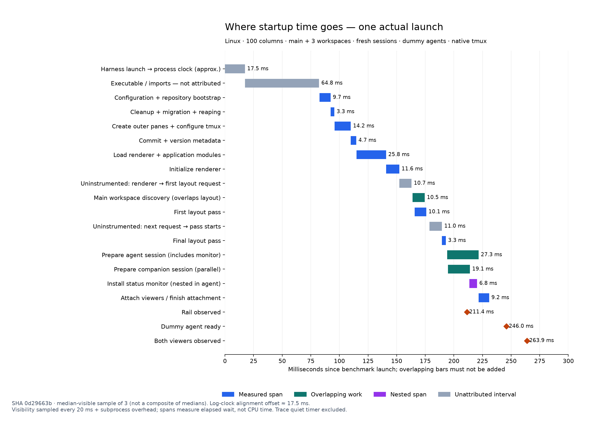

# Startup follow-up: renderer and bootstrap gaps

The previous waterfall was not a minimum. Two measured changes remain: defer renderer imports until a process actually needs the UI, and use OpenTUI native Unicode width measurement instead of cold JavaScript Unicode regular expressions.

Candidate binary SHA `0d29663b776f20cd670fbf8703665742a74fcc9bad6868b0755b2954b5718570`; comparison binary SHA `2302b230d0c5a75a9b298f9631082d0a1680afccb6c9dd5e50f537215afd83f5` from the first PR implementation. Preserved installations include matching source and assets, not just the executable. A subsequent comment correction does not change executable behavior.

## Final combined measurements

180 alternating baseline/candidate samples passed with no failures: 120 inside tmux and 60 from a real PTY outside tmux. Five observations per build/case; widths 80/100/160; fresh and retained sessions; Unicode guitar profile icon. Inside cases include main alone and three registered workspaces; outside cases use three. OS caches are not flushed. Dummy agents and stubbed provider responses exclude real Claude, network, and macOS costs. No builds, tests or QA ran alongside these measurements. Read-only code reviews ran during measurement.

Times below are medians in milliseconds for **three registered workspaces**. Visibility is polled every 20 ms plus observer subprocess overhead; small differences and individual outliers must not be read as precise CPU savings. Raw artifacts retain every observation, including outliers. The required-viewers metric can precede rail visibility; both are shown separately.

| Launch       | Width | Sessions | Rail before → after | Viewers before → after |
| ------------ | ----- | -------- | ------------------- | ---------------------- |
| Inside tmux  | 80    | Fresh    | 231.5 → 230.3       | 232.4 → 231.2          |
| Inside tmux  | 80    | Retained | 208.2 → 211.2       | 209.2 → 212.2          |
| Inside tmux  | 100   | Fresh    | 208.6 → 209.9       | 262.7 → 260.6          |
| Inside tmux  | 100   | Retained | 211.4 → 213.7       | 238.9 → 215.7          |
| Inside tmux  | 160   | Fresh    | 208.0 → 212.4       | 261.5 → 266.7          |
| Inside tmux  | 160   | Retained | 211.4 → 212.0       | 238.5 → 213.7          |
| Outside tmux | 80    | Fresh    | 347.6 → 307.9       | 352.6 → 327.2          |
| Outside tmux | 80    | Retained | 305.0 → 281.5       | 305.1 → 282.6          |
| Outside tmux | 100   | Fresh    | 327.3 → 283.1       | 359.0 → 332.7          |
| Outside tmux | 100   | Retained | 311.7 → 286.4       | 336.8 → 288.3          |
| Outside tmux | 160   | Fresh    | 327.1 → 283.1       | 380.9 → 334.7          |
| Outside tmux | 160   | Retained | 308.2 → 286.1       | 335.9 → 287.9          |

[Inside raw comparison](workspace-startup-combined-inside-comparison.json), [outside raw comparison](workspace-startup-combined-outside-comparison.json). Main-only inside-tmux cases showed about 22–25 ms earlier rail visibility at 100/160 columns; three-workspace first rail paint was roughly unchanged. Do not generalize the outside-launch benefit to every inside launch.

## Attribution and rejected routes

- Temporary entry probes put runtime work before entry at 45–47 ms, module initialization at 31–32 ms, and argument parsing at about 4 ms. These are separate diagnostic runs, not subdivisions of the historical waterfall sample
- JSC sampling identified cold Unicode regex work under `stringWidth → widestLine → truncateToWidth → SpaceListItem`: 52/61/58 samples in three baseline profiles, zero in two native-width profiles. Profiling perturbs startup; sample counts are attribution evidence, not precise elapsed-time savings
- Individual application effects were below 1 ms. Remaining React/OpenTUI text-node and layout construction explains part of the renderer gaps; they were not simply idle delays
- Lazy CLI imports alone did not help: `providers → beads-provider → issue-viewer → popup host → popup presenter → renderer` still loaded the renderer. Deferring the popup imports removed that chain. A 20-sample comparison against the truncation-only candidate improved outside launch by about 24 ms before the final combined comparison
- A truncation-only native-width candidate passed 180 comparison samples and improved retained viewer visibility at 100/160 columns by about 25 ms. The final shared helper also covers profile emoji, frame titles, ready work, and popup sizing
- Synchronous initial React rendering and skipping no-argument CLI parsing showed no reliable gain in their 20-sample pilots and were reverted

Diagnostic artifacts: [bootstrap probes](workspace-startup-bootstrap-attribution.json), [CPU attribution](workspace-startup-cpu-attribution.json), [effect probes](workspace-startup-effect-diagnostic.json), [render probes](workspace-startup-render-diagnostic.json), [native-width comparison](workspace-startup-native-width-full-comparison.json), [lazy-popup comparison](workspace-startup-lazy-popup-outside-comparison.json), [synchronous-render pilot](workspace-startup-sync-render-pilot.json), [argument-parser pilot](workspace-startup-noargs-parse-pilot.json). The initial CPU diagnostic attempt did not produce profiles because it awaited the long-lived CLI; use the attribution artifact and subsequent profiled runs instead. Diagnostic native-width spans included one overlapping focused test and are not clean comparative performance evidence.

## Updated waterfall and filter return

This is the median-visible actual sample of three traced fresh launches at 100 columns with three workspaces, without the optional profile emoji. It is not a composite of independently calculated medians. Approximate log-clock alignment is 17.5 ms; spans measure elapsed time including waits, not CPU utilization. Rail visibility is 211.4 ms, dummy agent readiness 246.0 ms, both viewers visible 263.9 ms in this sample. The 300 ms trace observation timer does not block readiness and is excluded.

The remaining pre-trace executable/import block is 64.8 ms. Renderer/application module loading is now visible as a separate 25.8 ms span, followed by 11.6 ms of renderer initialization. Initial/final layout passes take 10.1/3.3 ms; gaps around rendering are 10.7/11.0 ms. Agent preparation takes 27.3 ms and overlaps 19.1 ms of companion preparation; viewer attachment takes 9.2 ms. These overlapping bars must not be added. The diagram covers the TUI process inside tmux: the outside-launch gain comes from skipping renderer loading in its parent, which this diagram does not include.

[Raw trace](workspace-startup-combined-waterfall.json), [selected sample](workspace-startup-combined-waterfall-summary.json), [SVG](workspace-startup-combined-waterfall.svg). Regenerate with `uv run --with matplotlib python -P scripts/benchmarks/startup-waterfall.py --input docs/workspace-startup-combined-waterfall.json --output-prefix docs/workspace-startup-combined-waterfall`.

Nine native filter-close cycles had a 44.7 ms median and 45.1 ms maximum. Nine cycles with an added 8 ms delay per tmux call had a 113.1 ms median and 156.8 ms maximum; all passed the 250 ms diagnostic budget. The delayed case also includes Python wrapper overhead and is synthetic. [Native evidence](workspace-startup-combined-filter-native.json), [delayed evidence](workspace-startup-combined-filter-delayed.json).

## Validation and review

Build and type checking passed. All 2,543 tests passed with `bun --bun ava --concurrency=4`; the first unrestricted run failed an existing 20 ms resize assertion, which passed focused and on the bounded full rerun. Lint passed with the existing warnings. All four status integrations and 24 compiled CLI tests passed. The lazy-popup dependency regression test fails against the original eager host and passes with deferred imports.

[Lifecycle QA](workspace-startup-followup-lifecycle-qa.md) passed ten exit/reopen cycles, three startup interruptions, retained process identities, and complete terminal-mode restoration. [Attached-terminal UI QA](workspace-startup-followup-ui-qa.md) passed family ZWJ icons, clipped Unicode issue titles, help, close confirmation, and the native issue popup. Owned fixture servers/processes and PTYs were cleaned up.

The extended QA harness exposed limits rather than new regressions: forced resize with long Unicode titles showed only the selected row on both [baseline](workspace-startup-followup-ui-baseline.json) and [candidate](workspace-startup-followup-ui-resize.json); a rapid Escape-then-slash sequence was interpreted as input before filter dismissal. The final popup check waits for actual rendered dismissal. The first fixture's provider stub had an invalid newline escape and was corrected. These failed attempts remain recorded; they are not counted as passes. Separate native/delayed filter benchmarks above passed all 18 cycles.

All three review tracks completed; [verified dispositions](workspace-startup-followup-review.md) distinguish the corrected stale comment, existing limitations, and retained tradeoffs.

## Remaining limits

This still does not establish a minimum. Runtime startup, native renderer construction, tmux pane setup, and real shell/agent startup remain possible targets, but deleting functionality or moving work past visible readiness is not evidence of a complete startup improvement. macOS and real Claude acceptance remain open under `pappardelle-3wf.6`.
