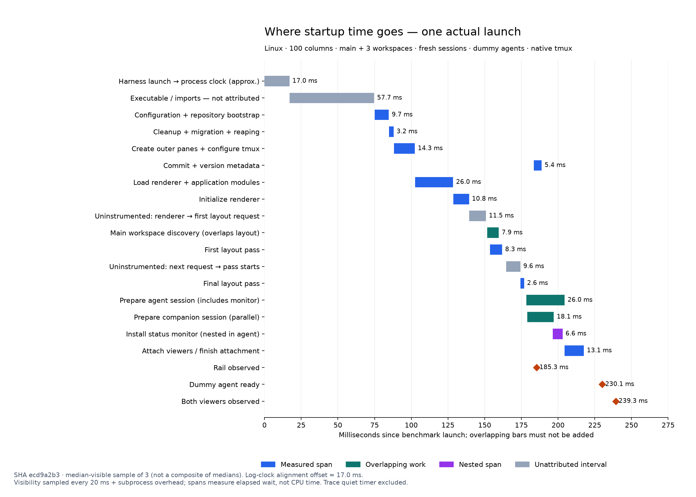

# Pre-paint deferral and Worker experiments

Tracks `pappardelle-3wf.13`, following the validated `b852014` startup changes. Experiments use isolated Linux tmux servers, dummy agents, local provider fixtures, and preserved executable installations. No macOS or real Claude claim follows from these measurements.

## Retained change

Keep background-only deferral: paint the rail before workspace detail loading, rail-status polling, skill warmup and display metadata lookup. Keep synchronous tmux maintenance and pane setup before rendering, and retain the original viewer attachment path. No Worker or experimental probe ships.

The final uninstrumented confirmation passed all 60 launches, 60 cold switches and 60 filter-return cycles. Across 80/100/160 columns, first rail visibility improved 9.6–10.4 ms fresh and 11.0–21.6 ms reopening. Fresh viewer readiness improved 8.6–12.1 ms; reopening viewers were unchanged or faster. These are interleaved Linux fixture comparisons, not macOS/real-agent claims.

| Width / mode    | Rail baseline → retained (ms) | Viewers baseline → retained (ms) |
| --------------- | ----------------------------: | -------------------------------: |
| 80x52 fresh     |                 221.1 → 211.5 |                    231.3 → 222.7 |
| 80x52 existing  |                 200.0 → 188.3 |                    191.9 → 180.2 |
| 100x52 fresh    |                 195.4 → 185.0 |                    241.3 → 229.2 |
| 100x52 existing |                 201.7 → 190.7 |                    214.2 → 213.8 |
| 160x52 fresh    |                 195.1 → 185.1 |                    240.0 → 228.8 |
| 160x52 existing |                 202.8 → 181.2 |                    215.6 → 204.9 |

Cold-switch visible readiness stayed approximately 42–47 ms and filter return approximately 45 ms. This final comparison uses a 5 ms polling sleep: its cold-switch values must not be compared directly to the earlier 20 ms polling/probe runs around 61–64 ms. No further cold-switch speedup is claimed.

Rejected: broad Worker routing, postpaint tmux maintenance/setup, and postponing initial attachment. Metadata-only deferral did not consistently improve fresh startup. Background-only deferral retains the measured gain without the attachment gate and its viewer-readiness tradeoff. A separate supervisor process is not justified by these cold-switch and background measurements.

Final source validation and running-app QA are recorded below; macOS/real-Claude acceptance remains open.

## What was measured

- Control: the preserved pre-Worker implementation with temporary timing probes, binary SHA `c3561b7ee05b6af1996f8d52cba349b1038f4e6dfc39bd8b80302fee7f6b9f63`
- Full deferral: draw the workspace list before orphan cleanup, legacy migration, pane setup, git SHA/version lookup and update checking. Issue/details, rail-status polling and skill warmup wait for initial maintenance. Attachments wait outside the layout queue, preserving migration-before-reap-before-attach ordering
- Worker: session maintenance, pane setup/reconciliation, session creation, monitor installation and viewer attachment run through a Bun Worker. Registry/worktree/main discovery, issue fetching, GraphQL parsing/state persistence and skill discovery also move to the Worker. React state application and rendering remain on the UI thread
- Combined: warm the Worker concurrently, paint first, then perform the deferred work through it
- Smaller deferral: retain pane setup before paint while deferring maintenance, metadata and nonessential background work

The corrected experimental binary is SHA `64e1ddf2f41302cee99199449b8fbc6d50b357cedfe853bb16c0d0b2b5f8f8f5`. Its source patch applies to `b852014`; it is an experimental native build, not a supported production Worker interface. Bun requires the Worker entry point to be included explicitly in a compiled executable. [Bun documentation](https://bun.sh/docs/compiler/executables#worker).

## Measurement boundaries

`workspace-ready.py --cold-switch` selects a workspace whose agent and companion sessions do not exist, then verifies their distinct readiness files, attached client sessions and visible markers. The cold-switch `railVisibleMs` field only confirms the existing list remains visible; it does not prove a new selected-row frame. Key dispatch and the next renderer frame are measured separately.

The temporary probe samples the main event loop every 2 ms, records rendered frames and key dispatch, and writes buffered records at exit. Harmless F12 input is sent after first rail visibility, during background observation, and throughout the cold switch. Dispatch latency includes the observer's tmux subprocess. A heartbeat gap includes OS scheduling delay, not only synchronous JavaScript. Frame gaps can include legitimate idle periods; the next frame after selection is not a pixel-level assertion. Visible readiness still uses 20 ms polling plus subprocess overhead.

All variants run alternately; host load varies on this shared machine. Comparisons between artifacts collected hours apart cannot establish an optimization. No builds, tests or QA run alongside measurement. A slow-tmux case adds 8 ms per call **plus Python-wrapper overhead**; it is synthetic, not an estimate of macOS latency.

Background coverage includes a 12-second observation through the normal 10-second workspace refresh, up to 30 workspaces with 100 fixture check runs per PR, and 200 skill folders. Skill discovery uses `node:fs/promises`, not synchronous folder walking; parsing and React updates can still occupy the main thread. Raw provider logs show the expected rail-status lookups.

## Superseded prototypes

The first deferred-metadata prototype called `root.render(App)` after `renderTui` had mounted `TuiErrorBoundary(App)`. That removed the wrapper and remounted the application, repeating initialization and polling. Deferral/combined timings before the `corrected-*` artifacts are **not retention evidence**. They remain recorded to explain the investigation. The corrected renderer update preserves the wrapper and component identity; native corrected runs show one poll per measured fresh startup.

This affects the original deferred-prepaint, full-defer, worker-deferred, worker-background, worker-native, true-baseline, early-input, many-workspaces and metadata-deferral artifacts. Control and Worker-only samples were not affected by the remount. Early retained-session probe files could also contain the preparation launch's timing data; those retained responsiveness summaries are excluded. Readiness values remain valid. The harness now removes the preparation probe file before the measured launch.

The fixture cleanup contributed by the user is preserved: descendants inherit `PAPPA_BENCH_FIXTURE`, teardown terminates marked processes before removal, stale runs are swept by their owning PID, and removal failures warn. The [real-process verification](../integration-tests/verify-benchmark-cleanup.py) confirms that owned and stale fixture processes are terminated while unrelated processes and live fixtures survive.

## Corrected measurements

All 80 corrected launches and cold switches completed successfully. Times below are medians in milliseconds; each native or metadata row has five observations, delayed rows three, and background rows two. Background rows use 30 workspaces, 100 check runs per PR, 200 skills and 12 seconds of observation. These are exploratory comparisons with timing probes enabled.

| Case              | Variant   |   Rail | Viewers | Cold viewers | Startup maximum input delay\* |
| ----------------- | --------- | -----: | ------: | -----------: | ----------------------------: |
| native fresh      | control   |  315.0 |   381.3 |         62.2 |                           3.2 |
| native fresh      | deferred  |  185.2 |   296.1 |         64.0 |                           6.3 |
| native fresh      | worker    |  317.3 |   376.4 |         63.2 |                           2.8 |
| native fresh      | combined  |  278.9 |   320.5 |         63.0 |                           2.9 |
| native existing   | control   |  243.0 |   247.3 |         61.7 |                           2.2 |
| native existing   | deferred  |  212.7 |   277.4 |         63.0 |                          12.6 |
| native existing   | worker    |  293.8 |   322.7 |         60.7 |                           2.1 |
| native existing   | combined  |  220.6 |   295.8 |         62.2 |                           9.9 |
| delayed fresh     | control   | 1165.4 |  1090.0 |        354.5 |                             — |
| delayed fresh     | deferred  |  182.3 |   949.9 |        358.0 |                         358.5 |
| delayed fresh     | worker    |  933.7 |  1260.3 |        352.7 |                           2.1 |
| delayed fresh     | combined  |  181.7 |   908.9 |        351.1 |                           2.1 |
| background fresh  | control   |  279.8 |   308.2 |         60.7 |                           2.0 |
| background fresh  | deferred  |  193.8 |   313.5 |         60.6 |                           8.9 |
| background fresh  | worker    |  296.7 |   338.8 |         63.7 |                           3.3 |
| background fresh  | combined  |  295.5 |   299.3 |         59.8 |                           6.5 |
| metadata fresh    | baseline  |  215.7 |   274.7 |         60.7 |                           2.7 |
| metadata fresh    | candidate |  216.5 |   272.6 |         61.3 |                           2.5 |
| metadata existing | baseline  |  249.9 |   253.3 |         61.0 |                           2.3 |
| metadata existing | candidate |  220.0 |   249.0 |         62.3 |                           2.9 |

\*Median of the per-run maximum F12 dispatch delays, after the rail becomes visible. A dash means no input observation in that interval, not zero latency. All input counts matched.

Native cold-switch selection reached the next renderer frame in roughly 3–4 ms across variants; viewers arrived in roughly 61–64 ms. With synthetic slow tmux, viewers needed roughly 351–358 ms, while selection-to-next-frame stayed roughly 3–4 ms. Moving this work to a Worker did not improve the cold-switch path.

In the background stress case, the median per-run maximum input delay was 2.5 ms for control, 3.2 ms for deferral, 2.4 ms for Worker and 2.8 ms combined. This fixture did not reproduce a background UI stall that would justify a separate supervisor process. It does not exclude stalls from larger real provider payloads or different platforms.

Full deferral moved synchronous pane setup after the first paint. Under synthetic slow tmux it then blocked input for a median worst delay of 358.5 ms. Combined deferral and Worker reduced that to 2.1 ms, but native reopening became slower (viewers 295.8 ms versus 247.3 ms control). Worker alone also made native reopening slower (322.7 ms). These broad routes are not suitable as unconditional startup changes on this evidence.

The smaller deferral kept pane setup before paint. Its first matrix showed unchanged fresh startup and earlier reopening rail paint. The next comparisons removed Worker imports and its embedded entry point to isolate the smaller deferral.

## Narrowing the deferral

The Worker-free maintenance/metadata prototype (SHA 3f75f161, patch) completed 64 native comparisons at 100/160 columns and 40 additional comparisons with a 5 ms polling sleep. The finer observer reduced the apparent fresh-viewer regression seen at 160 columns: normal polling gave 239.7 → 265.7 ms, finer polling gave about 243 → 246 ms. Observer phase matters at this scale; it is not evidence of a 26 ms increase in actual agent startup. The finer observer also adds subprocess load.

However, 12 synthetic slow-tmux comparisons exposed a real remaining problem: deferring maintenance after paint introduced about 69 ms of input delay and delayed viewer readiness. The 25 ms native rail improvement alone does not settle that tradeoff.

A second narrower prototype (SHA 3a2eb5ab, patch) keeps maintenance and pane setup before paint, deferring display metadata and gating background work/attachments until paint. Its 40 comparisons still showed earlier rail visibility. The next isolated variant removed the background/attachment gates to determine whether those extra coordination changes were necessary.

## Candidate selected for uninstrumented validation

Metadata-only deferral (SHA 72f9e84e) did not consistently improve fresh rail paint: baseline/candidate medians were 195.7/194.6 ms at 100 columns and 196.4/196.8 ms at 160 columns. Moving metadata alone is insufficient.

The narrowed candidate keeps orphan cleanup, migration, reaping and pane setup before rendering. Initial viewer attachment, workspace details, polling and skill warmup wait for the first settled rail frame. Display metadata is then loaded without remounting App. The first frame is an existing workspace list with cached information; subsequent detail updates use the existing row update path. Cold-switch attachment remains unchanged after this one startup gate.

With synthetic slow tmux, the instrumented narrowed candidate paints the rail at 576.0 versus 934.0 ms on fresh startup and 580.4 versus 810.7 ms on reopening. Median per-run maximum input delays after paint are 1.9/2.4 ms. This has a cost: fresh viewers arrive at 921.2 versus 859.0 ms, reopening viewers at 792.4 versus 736.7 ms. It improves early rail interaction by changing startup order, not by reducing every latency.

The uninstrumented candidate is SHA 71fb3f5f95e5bd6227da46660cf820eb970cfebaeefc5540792b2eddade05e77. It contains no Worker, experimental flags or heartbeat/input probes. Validation so far: build, typecheck, focused lint (existing app length warning), all 2,546 AVA tests, and fixture teardown integration pass. The metadata rerender regression was verified red when the error-boundary wrapper was dropped and green when preserved. The first-paint detail test was verified red with the gate removed and green with it restored. This candidate was subsequently narrowed further; final validation is recorded below.

## Removing the attachment gate

The 60-sample uninstrumented first-paint candidate passed all startup, cold-switch and filter-return checks, but delaying attachment cost about 17 ms of fresh viewer readiness at 80 columns. It is superseded by a smaller background-only candidate: metadata, workspace details, status polling and skills wait for first paint; viewer attachment follows the original path.

The first 36 uninstrumented background-only comparisons (SHA ecd9a2b3d8b35cd4e41a043fbacb6c17e7d49fdff2ab308922d34c2fd4ca6776) gave these medians:

| Width/mode      | Rail baseline → candidate | Viewers baseline → candidate |
| --------------- | ------------------------: | ---------------------------: |
| 80x52 fresh     |             212.1 → 214.1 |                222.3 → 224.4 |
| 80x52 existing  |             200.4 → 191.8 |                192.3 → 182.7 |
| 100x52 fresh    |             195.2 → 185.7 |                247.7 → 233.2 |
| 100x52 existing |             201.5 → 191.0 |                214.2 → 214.1 |
| 160x52 fresh    |             195.3 → 186.1 |                250.1 → 233.9 |
| 160x52 existing |             201.8 → 189.8 |                213.9 → 212.6 |

The smaller candidate removes the additional attachment cancellation/queue coordination. The 60-sample confirmation with cold switches and filter cycles passed and supports retention, as summarized above.

## Final validation and evidence

- 96 uninstrumented native comparisons, 16 outside-tmux comparisons, four 30-workspace stress comparisons and three separate traced launches passed with no readiness failures
- Outside-tmux checks include zero/three registered workspaces, fresh/reopened sessions and a family-ZWJ profile emoji
- Stress checks include 100 check runs per PR, 200 skill directories and 12 seconds through the 10-second refresh, followed by a cold switch and filter return
- All 2,546 AVA tests passed with concurrency four; native build, typecheck and lint passed (existing app-length warning)
- [Lifecycle QA](workspace-startup-background-lifecycle-qa.md): ten retained-PID reopen/quit cycles, three startup SIGTERM checks, complete terminal-mode restoration. Pre-mount q handling and teardown errno5 are documented baseline behavior
- [Attached-terminal UI QA](workspace-startup-background-ui-qa.md): Unicode rail, help, close cancellation and native issue popup passed without warning/error logs
- The user-contributed fixture cleanup is preserved and verified with real processes. Final audit found zero marked fixture processes and zero benchmark fixture directories

The waterfall is one median-viewer sample from three separately traced launches, not summed medians. Its 57.7 ms executable/import interval remains unattributed. Renderer/application loading adds 26.0 ms, renderer initialization 10.8 ms, tmux maintenance 3.2 ms and initial pane setup 14.3 ms. These are elapsed spans, not CPU attribution. Overlapping session preparation must not be added to the other bars. The rail is observed at 185.3 ms and both dummy viewers at 239.3 ms. This is not a claim of a physical minimum.

Raw records, the experiment source patches and the probe summarizer are not committed. They stay in the gitignored `benchmark-results/` directory of the checkout that produced them, like the harness output on `main`. All 674 samples were kept there, including superseded prototypes; only the corrected comparisons support the conclusions. The committed harness has no experiment switches: the Worker, deferral and timing-probe variants need patched builds.

## Post-review confirmation

The reviewed source (SHA `5458bb90`) was compared once more against the preserved `b852014` build (SHA `0d29663b`): 60 alternating launches, three registered workspaces, 5 ms polling, each followed by a filter round trip and a cold switch. All passed. The host was busy (load average 6-8), so ranges are wider than in the earlier runs. Medians in milliseconds, range in brackets:

| Width / mode    | Rail baseline → retained                  | Viewers baseline → retained               |
| --------------- | ----------------------------------------- | ----------------------------------------- |
| 80x52 fresh     | 236.7 [220.3-277.6] → 210.9 [207.5-229.0] | 238.4 [230.0-294.7] → 224.4 [221.0-230.9] |
| 80x52 existing  | 210.0 [206.9-225.1] → 196.2 [195.1-196.7] | 199.3 [196.6-202.9] → 186.3 [185.3-186.5] |
| 100x52 fresh    | 198.2 [195.5-210.9] → 184.2 [182.6-195.2] | 243.4 [241.5-248.2] → 243.8 [239.5-251.5] |
| 100x52 existing | 223.0 [196.8-253.1] → 200.6 [189.9-241.4] | 226.5 [214.9-257.7] → 222.5 [217.3-268.4] |
| 160x52 fresh    | 207.7 [195.8-218.8] → 198.1 [180.6-202.4] | 253.6 [240.8-263.0] → 242.2 [238.8-258.2] |
| 160x52 existing | 200.9 [198.3-217.5] → 188.1 [185.7-231.4] | 218.4 [216.3-225.6] → 218.7 [208.0-252.7] |

The rail is 9.5-25.8 ms earlier in every case. Viewer readiness is unchanged or up to 14 ms earlier. Cold-switch viewers stayed within 3 ms (54-65 ms) and filter return at 44 ms.

Deferring the main row's status, dirty flag and emoji as well was tried on top of this (24 samples) and dropped: fresh rail and viewer medians were slower at both widths. That run had load average up to 4 and ranges up to 721 ms, so it is weak evidence; `pappardelle-3wf.22` tracks a quieter repeat.

These measurements predate the pane frames that arrived with the OpenTUI migration merge. `pappardelle-3wf.14` re-baselines on the rebased branch.

The three review tracks are complete; see the [review disposition](workspace-startup-background-review.md).
