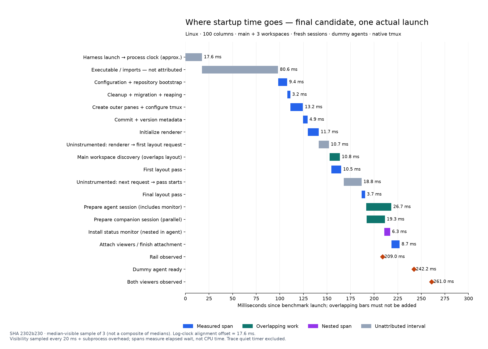

# Startup waterfall

This is the historical pre-follow-up waterfall, not a demonstrated minimum. The [follow-up investigation](workspace-startup-followup-results.md) identified removable renderer imports and cold Unicode regex work. See the [updated waterfall](workspace-startup-combined-waterfall.png) and raw trace for the combined candidate.

The diagram uses the middle-visible sample of three fresh launches of candidate SHA `2302b230`, at 100 columns with three registered workspaces. It uses actual overlapping spans from one launch, not separately calculated medians. All three launches passed: rail visibility 208.1–209.0 ms, required viewer visibility 260.1–262.9 ms. These are Linux fixtures with dummy agents, not real Claude or macOS measurements.

Process-uptime spans are aligned to the benchmark clock using the median difference between log timestamps and span timestamps (approximately 17.6 ms). Log timestamps have millisecond precision. Visibility has 20 ms polling plus observer subprocess overhead. The approximately 18.8 ms between dummy readiness and observed visibility cannot be assigned entirely to application work. The trace's 300 ms quiet observation timer is excluded because it does not block startup.

## What could still improve

- **Executable initialization/imports: 80.6 ms before tracing starts.** An earlier isolated import probe attributed about 40 ms to pre-entry runtime work and 20 ms to OpenTUI core loading, but that is a different executable/order, not a subdivision of this exact bar. Profile this build's module initialization before choosing dependencies to remove or defer
- **Renderer/layout scheduling: 10.7 ms before the initial request and 18.8 ms from the next request to its pass starting.** These are measured gaps, not proven idle time. Instrument React commits, effects, synchronous background work and renderer frame scheduling. They are stronger candidates than the final tmux pass itself, which takes only 3.7 ms
- **Initial pane setup: 13.2 ms; metadata: 4.9 ms.** Some commands might be batched or metadata precomputed, but even deleting the entire measured blocks would not remove the larger initialization and scheduling intervals
- **Agent preparation: 26.7 ms, including 6.3 ms monitor installation; viewer attachment: 8.7 ms.** Companion preparation already overlaps agent preparation. Removing the monitor gate would risk losing initial status. Earlier preparation and background deferral were previously tested without a reliable combined-visibility gain

The rail becomes visible before session preparation finishes. For rail launch feel, focus first on module initialization and the renderer/layout gaps. For real agent readiness, measure the user's interactive shell and Claude process separately; those are replaced with a controlled dummy here.

Source data: raw spans, selected sample and alignment, SVG. Regenerate with `uv run --with matplotlib python -P scripts/benchmarks/startup-waterfall.py`.
